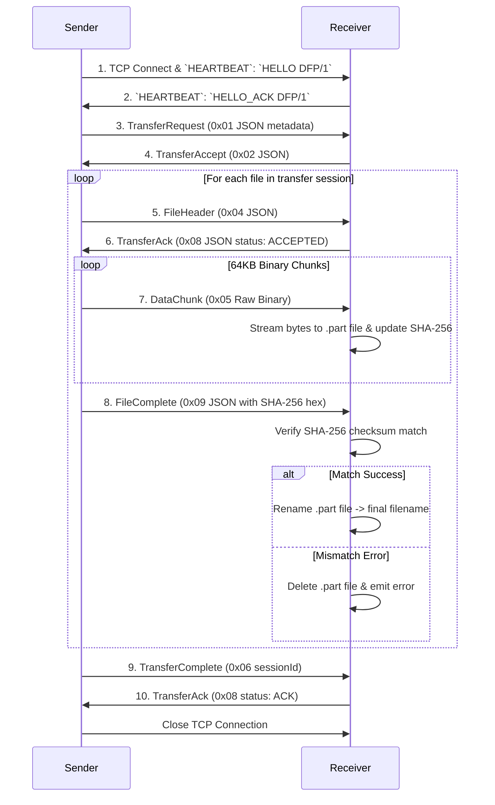

# DropFlow Transfer Protocol Specification (DFP/1)

Version: `1`  
Protocol String: `DFP/1`  
Magic Bytes: `DFP1` (`0x44 0x46 0x50 0x31`)  
Default Port: `42100`  
Multicast Group: `224.0.0.251`  
Service Type: `_dropflow._tcp`  

---

## 1. Overview & Architecture

DropFlow uses a local-first, peer-to-peer binary transfer protocol over TCP with mDNS service discovery (`_dropflow._tcp`). Transfers require zero internet access, cloud accounts, or third-party servers.

### Key Characteristics
- **Binary Header**: Fixed 10-byte global packet header.
- **Raw Binary Streaming**: File contents are streamed as raw binary chunks of up to 256 KiB (receivers accept up to 1 MiB).
- **Streaming IO**: Memory consumption is bounded by the chunk size, supporting 10GB+ files cleanly.
- **SHA-256 Verification**: Integrity is validated per file via SHA-256 digest comparison.
- **Cancellation & Cleanup**: Aborted transfers immediately delete `.part` temporary files and notify peers.

---

## 2. 10-Byte Global Packet Header

Every frame sent over a DropFlow TCP socket starts with a 10-byte header:

```text
 0                   1                   2                   3
 0 1 2 3 4 5 6 7 8 9 0 1 2 3 4 5 6 7 8 9 0 1 2 3 4 5 6 7 8 9 0 1
+-+-+-+-+-+-+-+-+-+-+-+-+-+-+-+-+-+-+-+-+-+-+-+-+-+-+-+-+-+-+-+-+
|       'D'     |       'F'     |       'P'     |       '1'     |  [0..3] Magic Bytes
+-+-+-+-+-+-+-+-+-+-+-+-+-+-+-+-+-+-+-+-+-+-+-+-+-+-+-+-+-+-+-+-+
|  Version (1)  |   Frame Tag   |       Payload Length          |  [4..7] Ver, Tag, Len (BE)
+-+-+-+-+-+-+-+-+-+-+-+-+-+-+-+-+-+-+-+-+-+-+-+-+-+-+-+-+-+-+-+-+
|  Payload Length (cont.)       |       Payload Bytes ...       |  [8..9] Len cont.
+-+-+-+-+-+-+-+-+-+-+-+-+-+-+-+-+-+-+-+-+-+-+-+-+-+-+-+-+-+-+-+-+
```

### Field Definitions
1. **Magic Bytes (4 bytes)**: `0x44 0x46 0x50 0x31` (`"DFP1"`)
2. **Protocol Version (1 byte)**: `0x01` (`DFP/1`)
3. **Frame Tag (1 byte)**: Frame identifier code
4. **Payload Length (4 bytes)**: Big-endian 32-bit unsigned integer specifying payload length in bytes.

---

## 3. Frame Tag Definitions

| Tag Name | Code (Hex) | Payload Type | Description |
| :--- | :--- | :--- | :--- |
| `TRANSFER_REQUEST` | `0x01` | JSON (`TransferMetadata`) | Initiates session with file list metadata |
| `TRANSFER_ACCEPT` | `0x02` | JSON (`TransferAckPayload`) | Recipient accepts transfer request |
| `TRANSFER_REJECT` | `0x03` | JSON (`TransferAckPayload`) | Recipient declines transfer request |
| `FILE_HEADER` | `0x04` | JSON (`FileHeaderPayload`) | Precedes individual file stream |
| `DATA_CHUNK` | `0x05` | Raw Binary Bytes | 64KB raw binary file chunk buffer |
| `TRANSFER_COMPLETE` | `0x06` | Text / JSON (`sessionId`) | Sent when all files in session finish |
| `TRANSFER_CANCEL` | `0x07` | JSON (`sessionId`) | Sent when user cancels transfer |
| `TRANSFER_ACK` | `0x08` | JSON (`TransferAckPayload`) | Acknowledges file header & resume offset |
| `FILE_COMPLETE` | `0x09` | JSON (`FileCompletePayload`) | Contains sender's final SHA-256 checksum |
| `HEARTBEAT` | `0x0A` | Text (`HELLO DFP/1`) | Handshake & keep-alive ping |
| `ERROR` | `0x0B` | Text | Reports why a peer stopped (DFP/1.1 batch mode) |
| `TRANSFER_REQUEST_LARGE` | `0x0C` | JSON (`TransferMetadata`) | DFP/1.1: a request whose manifest exceeds 64 KB |
| `RESUME_STATE` | `0x0D` | JSON array | DFP/1.1: what the receiver already holds |

---

## 4. Transfer Sequence & State Machine



---

## 5. Storage Strategy & Checksum Flow

1. **Android Receive Location**:
   Default: `/storage/emulated/0/Download/DropFlow/`
2. **Partial Files**:
   During active streaming, files are saved as `filename.ext.part`.
3. **Collision Handling**:
   If `filename.ext` already exists, receiver generates `filename (1).ext`.
4. **SHA-256 Integrity Verification**:
   - Both sender and receiver compute `MessageDigest.getInstance("SHA-256")` dynamically during streaming.
   - On `FileComplete`, receiver compares its hexadecimal digest with sender's checksum string.
   - If matched: `.part` file is renamed to final destination path.
   - If mismatched: `.part` file is deleted immediately and error `SHA256_MISMATCH` is logged.

---

## 6. Error Handling & Teardown

- **Handshake**: Every connection begins with a `HEARTBEAT` `HELLO DFP/1` / `HELLO_ACK DFP/1` exchange before any transfer frame. Both desktop and Android enforce it.
- **Frame bounds**: Metadata and control frames are limited to 64KB. `DATA_CHUNK` frames are limited to 1MB and must not exceed the remaining bytes declared by the current file header.
- **Completion acknowledgement**: A sender treats a transfer as complete only after the receiver has validated every file, processed `TRANSFER_COMPLETE`, and returned `TRANSFER_ACK` with status `ACK`.
- **Cancellation**: User tapping Cancel sends `FrameTag::Cancel` (`0x07`). Socket streams are closed and incomplete `.part` files are unlinked.
- **Timeouts**: Socket read timeout set to `15,000ms`. Failure to receive frames closes session safely without crashing.

---

## 7. DFP/1.1: negotiated features

DFP/1.1 keeps the DFP/1 header, version byte (`1`), handshake and frames. It
adds capabilities that two peers turn on only when **both** ask for them. A
peer that knows nothing about them sees the DFP/1 exchange of sections 2–6,
byte for byte. Reference implementation: `apps/desktop/src-tauri/src/transfer_manager/session.rs`
(tests in `session_tests.rs`, command-line peer in `examples/dfp_peer.rs`).

### 7.1 Negotiation

1. The sender adds `"features": ["batch", "resume"]` to the `TransferMetadata`
   JSON. Older receivers ignore unknown JSON fields.
2. A receiver that wants any of them answers `TRANSFER_ACCEPT` with JSON
   `{"status":"ACCEPTED","features":[...]}` listing the subset it grants.
   `resume` is only valid together with `batch`. A receiver that grants
   nothing answers exactly as in DFP/1 (desktop: the text `ACCEPTED`; Android:
   `{"status":"ACCEPTED",...}` without `features`).
3. The sender uses a feature only if it offered it **and** the accept lists it.
   An accept payload that is not JSON, or has no `features`, grants nothing.

The sender never puts local paths in the request. `finalPath` is not sent.

A request is read before anyone approves it, so receivers bound it while
parsing: at most 16 feature names of at most 32 bytes, `senderId` ≤ 128 bytes,
`senderName` ≤ 256, `senderPlatform` ≤ 64, each `relativePath` ≤ 1024. A
request outside these limits is dropped.

### 7.2 Large manifests

A request JSON over 64 KB is sent with tag `0x0C` instead of `0x01`. Its
payload limit, and that of `0x0D`, is 16 MiB; every other control frame keeps
the 64 KB limit. A DFP/1 peer drops the connection on tag `0x0C`. A sender that
loses the connection within 5 seconds of sending a large request reports that
the other device needs a newer DropFlow. Receivers must not allocate the
claimed length up front; grow the buffer as bytes arrive.

### 7.3 `batch`

After the accept (and `RESUME_STATE`, see 7.4) the sender streams, with no
reply expected until the end:

```text
for each file, in manifest order:
    FILE_HEADER      {"fileIndex","relativePath","sizeBytes","sha256Checksum":"","resumeOffset"}
    DATA_CHUNK ...   exactly sizeBytes - resumeOffset bytes in total
    FILE_COMPLETE    {"fileIndex","bytesWritten": sizeBytes,"sha256Checksum": <64 hex, whole file>}
TRANSFER_COMPLETE    <session id>
```

then waits for the final `TRANSFER_ACK` (`ACK`). Differences from DFP/1:

- **No per-file `TRANSFER_ACK`.** The receiver does not send one and the sender
  does not wait for one.
- **`FILE_COMPLETE.sha256Checksum` is required.** An empty digest is an error.
- **`HEARTBEAT` frames (any payload, normally empty) may appear between any two
  frames in either direction** and are skipped. A peer sends one about every
  2 seconds whenever it has sent nothing else: the receiver for the whole
  session (hashing staged data before the accept, receiving, and saving before
  the final acknowledgement), the sender while it hashes a resume prefix. The
  receiver's are needed even while data flows: a sender can have written a
  whole folder of small files into the socket buffers and be waiting for the
  final reply while the receiver is still creating files. Read timeouts stay at 15 seconds (75 seconds while waiting for the
  accept) and apply per frame.
- **Either side may stop with a reason.** At a frame boundary a peer may send
  `TRANSFER_CANCEL` (the person cancelled; payload empty or the session id) or
  `ERROR` (short UTF-8 text with no local paths, for example
  `not enough storage space`). The sender checks for pending input without
  blocking roughly every 100 ms while streaming, and treats those two tags at
  the final acknowledgement the same way. After sending a notice a peer (sender or
  receiver) shuts down its write side and keeps reading and discarding input
  for up to 1.5 seconds or until the other side closes; closing with unread input resets the
  connection and can destroy the notice. Never send a notice in the middle of a
  frame.
- Senders may group small frames into one socket write. Frame contents do not
  change.

Destination folders are created when a file's header arrives, so a name
conflict stops the transfer before anything is saved. Once every file is
verified, saving is not interruptible: a cancel or a lost connection at that
point no longer stops it, because stopping would leave the transfer half saved.

Completion is unchanged: the receiver verifies every file, saves all of them,
and only then sends the final `TRANSFER_ACK`. The sender reports success only
after reading it. Nothing is published to the destination before the whole
transfer is verified.

### 7.4 `resume`

When `resume` is granted the receiver keeps what it has received if the
**connection fails**, and continues from there when the same sender offers the
same files again. A retry is a new session with a new session id.

- The receiver keys staged data by the sender id plus every file's
  `relativePath` and `sizeBytes`, in order. Nothing in the request names the
  key, so a different manifest can never reach another transfer's data.
- Staged data is deleted when the transfer completes, when either person
  cancels, on a checksum or protocol error, and when it is older than 3 days.
  It is kept only for connection failures.
- Right after its `TRANSFER_ACCEPT`, a receiver that granted `resume` always
  sends `RESUME_STATE` (tag `0x0D`): a JSON array, possibly empty, of
  `{"i": fileIndex, "o": bytesHeld, "h": "<sha-256 hex of exactly those bytes>"}`
  with `0 < o <= sizeBytes`. Hashing happens after the person approves and
  before the accept, with heartbeats.
- For each listed file the sender hashes its own first `o` bytes. If the digest
  equals `h` it sends `FILE_HEADER` with `resumeOffset = o` and only the
  remaining bytes (none when `o == sizeBytes`). Otherwise it sends
  `resumeOffset = 0` and the whole file. `FILE_COMPLETE` always carries the
  digest of the whole file.
- The receiver accepts `resumeOffset` only if it is `0` or exactly the `o` it
  offered for that file. For `0` it discards what it had for that file. For `o`
  it appends, continuing the hash from the state it computed for the offer.

Known limit until devices are authenticated (planned with encryption): the
sender id is not verified, so an approved device that claims another sender's
id and the same file names and sizes is told how much of that transfer is
staged and the hash of it. It gains nothing it could not already send.

Resume never trusts stored state: both sides hash the actual bytes they hold,
and the whole-file digest is still verified at the end.

### 7.5 Compatibility matrix

| Sender | Receiver | Exchange |
| --- | --- | --- |
| DFP/1 | DFP/1 or DFP/1.1 | DFP/1 (no `features` offered) |
| DFP/1.1 | DFP/1 | DFP/1 (accept grants nothing); over 64 KB of manifest fails with a clear message |
| DFP/1.1 | DFP/1.1 | `batch`, plus `resume` when the receiver grants it |

DropFlow desktop grants and offers both. A peer may grant `batch` alone.
